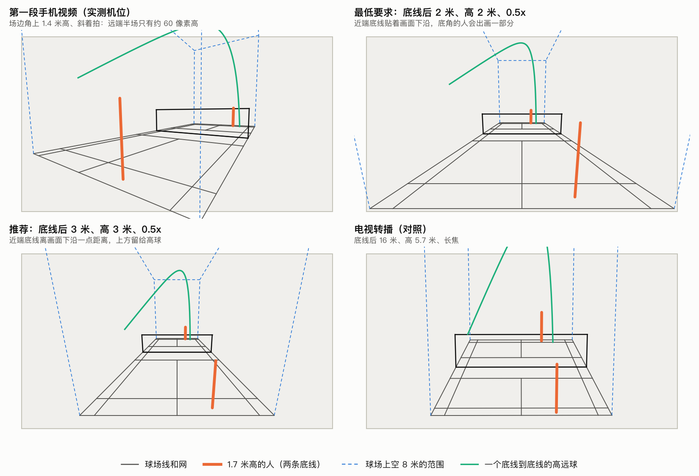
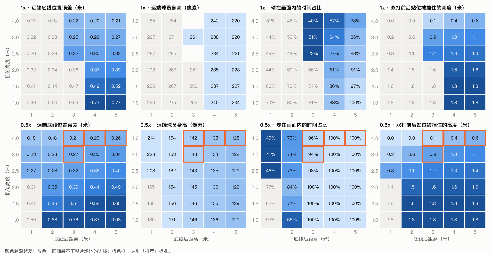
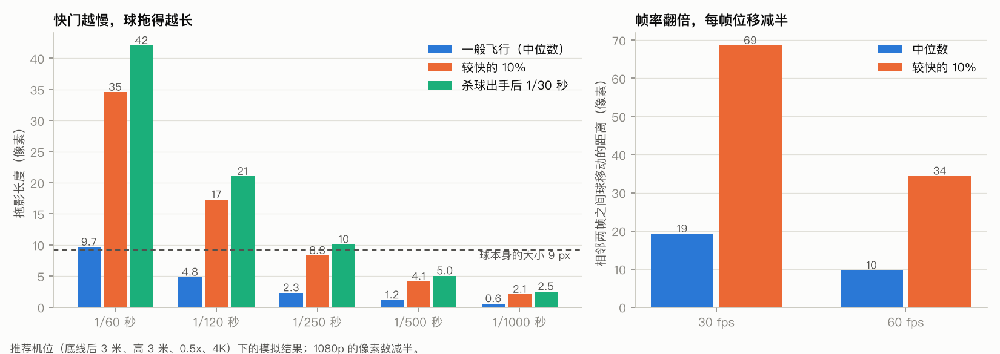

# 录像指南

怎么架手机，分析结果才靠得住。每一条后面的数字都是 `scripts/recording_planner.py` 按针孔相机模型算出来的，并用两段真实视频核对过（见文末）。

## 一页清单

| # | 做什么 | 为什么（算出来的数字） |
| --- | --- | --- |
| 1 | **用三脚架或灯架固定**，不要手持，不要放在会被碰到的地方 | 球场标定只做一次，机位一动整段视频的位置都会偏。远端底线附近画面上 1 个像素等于场上 7–17 厘米，手抖几个像素就是几十厘米 |
| 2 | **架高到 3 米**（至少 2 米） | 远端位置误差和高度成反比：底线后 3 米处，高 1.5 / 2 / 3 / 4 米时，远端底线误差是 0.51 / 0.39 / 0.27 / 0.21 米。双打前后站位时，前面的人被后面搭档挡住的高度是 1.75（全挡）/ 1.57 / 0.86 / 0.15 米 |
| 3 | **放在底线后方正中，离底线 3 米**（至少 2 米） | 0.5x 镜头在 3 米处能装下整片场地，球有 94% 的飞行时间在画面里；2 米处降到 84%，近端两个底角的人会出画一部分；1 米处要把镜头压得很低才装得下场地，球只有约 40% 的时间在画面里 |
| 4 | **用 0.5x 超广角** | 1x 主摄要退到底线后 4–5 米才装得下四条边线，退到 5 米球也只有 86% 的时间在画面里；一般球馆没有这个空间 |
| 5 | **4K、60 fps** | 0.5x 下远端球员在 1080p 里只有 71 像素高，低于姿态模型需要的 80–100 像素；4K 是 143 像素。60 fps 让球每帧的位移减半（中位数 19 → 10 像素，最快的 10% 从 69 → 34 像素） |
| 6 | **关闭 HDR 视频**（设置 → 相机 → 录制视频 → HDR 视频） | HDR 的颜色按普通视频解码会发灰，模型是用普通视频训练的 |
| 7 | **快门 1/500 秒**（馆里暗就 1/250 秒），用 Blackmagic Camera 这类免费 App 设置 | 系统相机在室内 60 fps 下大约是 1/60–1/120 秒，快球会拖成 17–35 像素长的线，而球本身只有 6–9 像素。1/500 秒时拖影 4 像素，比球还短。再快没有必要：1/1000 秒要把感光度再翻一倍，画面噪点变多 |
| 8 | **锁定对焦和曝光** | 自动曝光会随着人走动忽明忽暗，自动对焦会偶尔「拉风箱」，这几帧的球和关节点都会丢 |
| 9 | **画面里要有整片场地和它上面的空间**：近端底线在画面下沿往上一点，远端底线大约在画面正中的高度 | 这样近端底线上方能看到 4.5 米，球网上方能看到 7.8 米；高远球最高点约 6.8 米。镜头再往下压，高球就出画了 |
| 10 | **避开亮的灯和窗户**；能选的话选靠墙的边场 | 静止的灯和地上的球，程序能按「总在同一个位置」滤掉；但隔壁场地在飞的球滤不掉，0.5x 会把相邻场地上空约 70% 的范围拍进来 |
| 11 | **录之前征得场上每个人同意**，原始视频留在本地 | 视频里是可以认出人的 |

另外：横屏；插电或带充电宝；4K 60 fps 每小时大约 24 GB，存储不够时用 4K 30 fps（约 10 GB）或 1080p 60 fps（约 5 GB），代价见下一节。

## 最低要求和推荐配置



| | 第一段手机视频（实测） | 最低要求 | 推荐 | 电视转播（对照） |
| --- | --- | --- | --- | --- |
| 机位 | 近端右角旁，高 1.4 米，斜着拍，手持 | 底线后 2 米正中，高 2 米，三脚架 | 底线后 3 米正中，高 3 米，灯架 | 底线后 16 米，高 5.7 米，长焦 |
| 镜头和参数 | 约 94° 视角，1080p 30 fps，HDR | 0.5x，4K 60 fps，关 HDR | 0.5x，4K 60 fps，关 HDR，快门 1/500 秒 | 34° 视角，1080p |
| 镜头下压角度 | 5° | 8° | 12° | 11° |
| 四条边线都在画面里 | 否 | 是，但近端两个底角的人会出画一部分 | 是 | 是 |
| 球在画面里的时间 | 76% | 84%（高远球 74%） | 94%（高远球 85%） | — |
| 球员位置误差：网前 | 0.27 米 | 0.19 米 | 0.15 米 | 0.13 米 |
| 球员位置误差：远端底线 | 0.73 米 | 0.35 米 | 0.27 米 | 0.21 米 |
| 远端球员身高 | 103 像素 | 154 像素 | 143 像素 | 174 像素 |
| 双打搭档被挡住的高度 | 1.75 米（全挡） | 1.52 米 | 0.86 米 | 1.03 米 |
| 远端的球有多大（各自的分辨率下） | 3.7 像素 | 5.9 像素 | 5.5 像素 | 6.8 像素 |

位置误差是单帧的数字（假设脚踝关节点偏 4 个像素），程序在时间上做平滑之后，跑动距离和热力图的误差会比它小。

**降一档会怎样**

- 推荐机位改用 **1080p**：远端底线误差从 0.27 米变成 0.54 米，远端球员只有 71 像素高，远端的姿态不可靠。近端半场不受影响。
- 最低要求机位改用 1080p：远端底线误差 0.70 米，和第一段视频差不多，不建议。
- 改用 **30 fps**：球员位置不受影响，球每帧移动的距离翻倍，快球更容易跟丢。
- 高度只有 **1.5 米**（普通三脚架）：远端底线误差 0.51 米，双打前后站位时前面的人被完全挡住。只适合单打、只看近端球员。

**预期效果**

- 球员位置和跑动：推荐配置下接近电视转播的水平，网前约 0.15 米，远端底线约 0.27 米。
- 姿态：两个半场的球员都在 140 像素以上，够用。
- 球：比第一段视频好（不抖、不拖影、94% 的时间在画面里、帧率翻倍），但达不到转播视频 95% 的水平。超广角下球很小，而目前的球追踪模型会先把整幅画面缩到 512 像素宽，远端的球缩完不到 1 个像素（转播是 1.8 个像素）。这一点要靠程序改进（先裁出球场范围再送进模型），换机位解决不了。

## 高度、距离和镜头怎么选



图里是 4K 60 fps、镜头下压角度取最合适时的结果，横轴是手机离底线的距离，纵轴是高度。

- **高度决定远端准不准。** 远端一个像素对应场上的距离约等于「距离的平方 ÷（焦距 × 高度）」，所以高度翻倍，误差减半。这也是减少双打遮挡最有效的办法。
- **距离决定装不装得下。** 离底线太近，近端两个底角在画面外面；退得越远，球在画面里的时间越长，但远端的人和球也越小。0.5x 镜头在底线后 3 米最合适。
- **镜头：** 1x 的像素更密（同样位置，远端球员大 1.7 倍），但视角只有 77°，要退到 4–5 米才够。场地后面有这么大空间、又能架到 3–4 米时，1x 加 1080p 也可以。0.5x 是暗一档的小镜头，快门 1/500 秒时感光度大约要 1200（按馆内照度 500 勒克斯算），画面会有噪点，可以接受。
- **场边和角上的机位都不行。** 网柱延长线上、离边线 3 米的位置，0.5x 也只能拍到九成左右的场地，两条底线的角都出画。底角旁边斜着拍，就是第一段视频的情况。这些位置只适合放第二台手机。

## 快门和帧率



图里是推荐机位、4K 下的像素数（1080p 减半）。球按几种常见的球路模拟：高远球、杀球（出手 70 米/秒，3 米内减到一半）、吊球、挑球、平抽、发高球。

- 球在网前上空大约 9 个像素，在远端底线 5.5 个像素。
- 快门 1/120 秒：较快的 10% 的时刻，球拖成 17 个像素以上的线，是球本身的 2–3 倍，颜色也被拉淡，容易漏。
- 快门 1/500 秒：同样时刻拖影 4 个像素；1/250 秒是 8 个像素，和球差不多大，馆里暗的时候可以接受。
- 30 fps 时球在相邻两帧之间移动 19 个像素（中位数），最快的 10% 超过 69 个像素；60 fps 时是 10 和 34 个像素，前后两帧更容易连上。

## 这些数字怎么来的

```bash
PYTHONPATH=src python scripts/recording_planner.py --docs docs      # 全部表格和图，写到 outputs/recording_guide/
PYTHONPATH=src python scripts/recording_planner.py --setup 3.05,-2.5,2.8,0.5x,4k,60   # 算你自己的机位
```

`--setup` 的六个数是：手机在球场坐标里的位置 x、y、高度（米；x = 3.05 是正中，y 为负表示在近端底线后面）、镜头（1x 或 0.5x）、分辨率（1080p 或 4k）、帧率。

**用两段真实视频核对。** 从每段视频的球场标定反推出相机的位置、朝向和视角，再用规划器按同样的参数重新合成一台相机，比较两边的数字：

| | 第一段手机视频 | 电视转播 |
| --- | --- | --- |
| 反推出的机位 | 近端右角外 0.6 米、底线后 1.6 米，高 1.43 米 | 正中，底线后 16.2 米，高 5.72 米 |
| 焦距 / 水平视角 | 891 像素 / 94° | 3114 像素 / 34° |
| 合成相机投出的标记点和手工点的位置相差 | 4.0 像素（标定本身的误差 2.1） | 5.0 像素（标定本身的误差 2.0） |
| 远端底线位置误差：规划器 / 程序里的算法 | 0.726 / 0.724 米 | 0.208 / 0.208 米 |
| 网前位置误差：规划器 / 程序里的算法 | 0.267 / 0.265 米 | 0.128 / 0.128 米 |
| 远端半场在画面里的高度：规划器 / 标定 | 55 / 55 像素 | 168 / 168 像素 |
| 远端底线处 1 个像素对应场上多少 | 17.6 厘米 | 5.1 厘米 |
| 球每帧移动的距离（30 fps），中位数：模拟 / 实测 | 14.5 / 13.0 像素 | 21.9 / 16.1 像素 |
| 同上，最快的 10%：模拟 / 实测 | 51 / 47 像素 | 46 / 43 像素 |

第一段视频里，远端球员常站的位置（离远端底线 3–4 米）算出来的位置误差是 0.46 米，和实际跟踪时看到的约 0.5 米的抖动一致。

**没有算进去的**

- 镜头视角用的是标称值（1x 约 77°，0.5x 约 108°）。开着防抖时画面会被裁掉一圈，实际视角更窄；架好之后先看一眼四条边线是不是都在画面里。
- 0.5x 的画面边缘有畸变，这里按没有畸变算。
- 「4K 能把远端误差减半」是一个假设：关节点的误差按球员身高的 2.5% 算，但不小于 4 个像素。还没有用真实的 4K 视频验证过。
- 球的数字来自模拟的球路，不是统计出来的。
- 灯光、衣服颜色、地板反光这些会影响效果的因素，这里算不出来。
